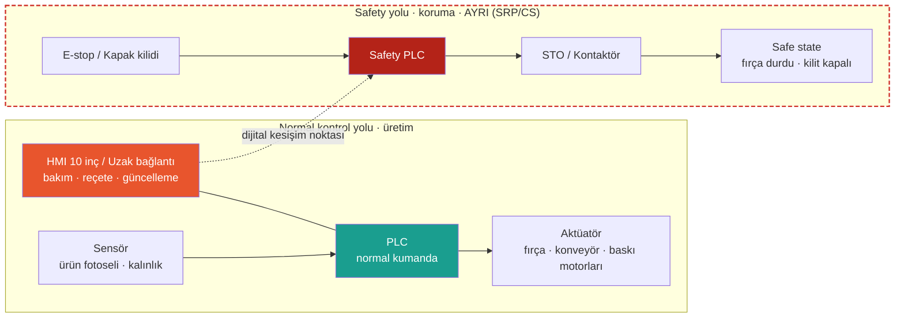

# Lab 1 · Safety Architecture

**Çıktı:** Safety Function Map  
**Makine:** Baromak LUNA 1300 PRO fırça zımpara  
**Ad Soyad:** Muhammed Cemil Çaka  
**Tarih:** 1. Hafta

PDF hâli: [hafta-1-safety-architecture.pdf](../pdf/hafta-1-safety-architecture.pdf)

> **Kavram:** Emniyet fonksiyonu, insanı koruyan fonksiyondur ve **ayrı bir safety yolunda** yaşar (E-stop → Safety PLC → STO). Gerekli güvenilirliği (PLr/SIL) riskle orantılıdır — ve bu güvenilirlik, **dijital bir konfigürasyona** bağlıdır.

## Safety Function Map

Kırmızı kesikli çerçeve: safety-related control system (SRP/CS).

## Görev — sırayla cevaplayın

### 1. Bu makinede tehlike nedir? İnsan neyden zarar görür?

Bence en büyük tehlike dönen fırça istasyonları. 6 istasyon var ve hepsi hem dönüyor hem de osilasyon yapıyor, yani sağa sola gidip geliyor. El, eldiven, bol kıyafet ya da uzun saç fırçaya kaptırılırsa sarılma olur, bu da kol kaybına kadar gidebilir. İkinci tehlike konveyörün giriş ağzı: parçayı elle sürerken parmak bant ile parçanın arasına girip içeri çekilebilir. Bakım sırasında en sinsi olanı da şu: motor durdurulsa bile fırçalar ağır olduğu için bir süre ataletle dönmeye devam ediyor, çekmeceli istasyonu erken açan kişi elini dönen fırçaya sokmuş oluyor. Bunların dışında kısa/ince parçanın geri fırlaması, ahşap tozu (hem solunum hem toz yangını), istasyonlardaki basınçlı hava üflemesi ve 380 V elektrik var.

### 2. Safety function (emniyet fonksiyonu) hangisidir?

Seçtiğim fonksiyon: **istasyon çekmecesi / bakım kapağı için kilitli koruyucu.** Kapak kapalı ve kilitli değilse fırça, osilasyon ve konveyör motorları çalışamaz. Kapağı açma isteği gelince motorlar durdurulur ve fırçalar tamamen durmadan kilit açılmaz. Acil stop ve konveyör girişindeki el koruması da birer emniyet fonksiyonu ama bu föyde kapak kilidini ana fonksiyon olarak aldım, çünkü zımpara değişimi ve temizlik yüzünden insanın her gün en çok yaklaştığı yer orası.

### 3. Safety-related control system nerede? Şemada işaretleyin.

Şemada kırmızı kesikli çizgiyle çerçeveledim. Giriş tarafı kapak/çekmece kilit switchleri ve acil stoplar, mantık kısmı safety PLC, çıkış tarafı da inverterlerin STO girişleri ile ana kontaktörler. Yani alttaki satırın tamamı SRP/CS; üstteki PLC ve HMI bunun dışında kalıyor.

### 4. Normal PLC ile Safety PLC farkı nedir?

Normal PLC üretimi yönetiyor: konveyör hızı, her istasyonun baskı ayarı, osilasyon, reçeteler, otomatik yağlama vs. HMI'dan ve uzaktan bağlantıdan sürekli komut alıyor, programı da sık değişebiliyor. Safety PLC'nin ise tek işi insanı korumak. Girişleri çift kanallı okuyor, kendini sürekli test ediyor, bir hata görürse durdurma tarafına geçiyor ve PL/SIL sertifikası var. Programı parola ve checksum ile kilitli, üretim ayarlarıyla hiç işi yok. Kısacası normal PLC bozulsa ya da ele geçirilse bile safety PLC motorları kesebilmeli.

### 5. PLr / SIL neden var? Bu fonksiyon için neden önemli?

Her emniyet fonksiyonunun aynı derecede güvenilir olması gerekmiyor, ne kadar güvenilir olacağını risk belirliyor. PLr de bunun ölçüsü. ISO 13849-1'deki risk grafiğiyle denedim: şiddet **S2** (fırçaya kol kaptırmak geri dönüşü olmayan bir yaralanma), sıklık **F2** (zımpara değişimi ve temizlik her vardiya yapılıyor), kaçınma olasılığı **P1** (fırça görünüyor, yavaşladığı fark ediliyor). Buradan **PLr d** çıktı. Ataletle dönen fırçayı fark etmek zor diye P2 dersek PLr e oluyor; açıkçası P1 ile P2 arasında kaldım. Fonksiyon için önemli çünkü PLr d demek çift kanal, diagnostik ve arıza toleransı demek; tek bir switch ya da tek kontaktörle bu iş çözülemez.

### 6. Safe state (güvenli durum) nedir?

Fırça motorları, osilasyon ve konveyörün enerjisiz ve gerçekten durmuş olması (sıfır hız), inverterlerde STO'nun aktif olması. Kapak kilidi fırçalar durana kadar kapalı kalıyor, istasyonlardaki hava üflemesi kesiliyor. Kapak kapatılıp reset'e basılmadan makine kendi kendine tekrar kalkmıyor. Burada dikkat ettiğim nokta şu: motora "dur" komutunun gitmiş olması safe state değil, fırçanın fiilen durmuş olması safe state.

### 7. Safety function hangi dijital bağımlılıklara sahip?

- Safety PLC programı ve parametreleri (kilit açma gecikmesi veya durma izleme ayarı, giriş filtre süreleri)
- Safety PLC firmware'i ve programın checksum'ı
- İnverterlerdeki STO ayarları ile fren / duruş rampası parametreleri (fırçanın kaç saniyede duracağını bunlar belirliyor)
- Mühendislik yazılımı ve onun kurulu olduğu servis laptopu
- Dolaylı olarak HMI'dan girilen reçete değerleri ve uzaktan bağlantı modemi

Yani fonksiyon kâğıt üstünde "donanım" gibi dursa da aslında birkaç dosyaya ve parametreye bağlı.

### 8. Siber müdahale hangi noktadan bu fonksiyonu bozar?

Bence en zayıf nokta üreticinin 7/24 uzaktan bağlantısı. Bu bağlantıyı ele geçiren biri HMI/PLC'ye, oradan da inverterlere ulaşabilir. Mesela fırça motorunun duruş rampasını 5 saniyeden 40 saniyeye çıkarırsa ve kapak kilidi sadece sabit bir süre bekleyip açılıyorsa, bakımcı çekmeceyi açtığında fırça hâlâ dönüyor olur. Safety programına kimse dokunmadan fonksiyon boşa çıkmış olur. İkinci nokta servis laptopu / USB (safety programı veya gecikme süresi değiştirilebilir), üçüncüsü parolasız HMI. Şemadaki sarı "dijital kesişim noktası" tam olarak bu.

---

_Bu föyün çıktısı **Safety Function Map** → Evidence Pack **EP 03 Safety Functions** başlığına oturur._
