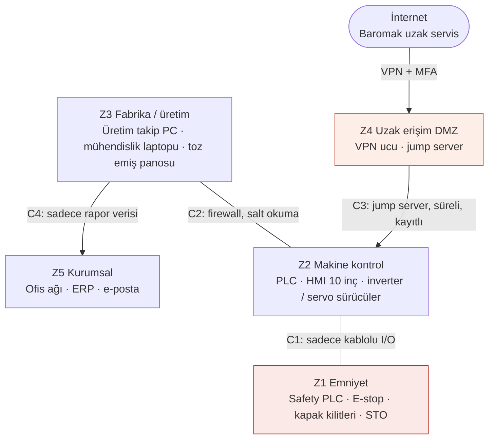

# Lab 2 · IEC 62443 Mini Workshop

**Çıktı:** Zone / Conduit Diagram  
**Makine:** Baromak LUNA 1300 PRO fırça zımpara  
**Ad Soyad:** Muhammed Cemil Çaka  
**Tarih:** 2. Hafta

PDF hâli: [hafta-2-iec62443-zone-conduit.pdf](../pdf/hafta-2-iec62443-zone-conduit.pdf)

> **Kavram:** **Zone** = benzer kritiklikteki cihazları bir bölgeye topla. **Conduit** = bölgeler arası her geçişe kontrollü bir kapı. 62443'ün maddesini ezberlemiyoruz — mantığını uyguluyoruz.

## Görev A — varlıkları bölgelere ayırın

**Varlık listesi:** PLC · HMI (10" dokunmatik) · İnverter / servo sürücüler · **Safety PLC** · Üretim takip PC'si (SCADA istemcisi) · Mühendislik / servis laptopu · Uzak servis erişimi (Baromak modemi) · Toz emiş panosu · Ofis ağı (ERP/e-posta)

### 1. Hangi varlıklar aynı bölgede? Bölgeleri adlandırıp gruplandırın.

Beş bölgeye ayırdım:

- **Z1 Emniyet:** Safety PLC, acil stoplar, kapak kilit switchleri, STO hatları. Ağa hiç çıkmasın istedim.
- **Z2 Makine kontrol:** PLC, 10" HMI, inverterler ve servo sürücüler. Hepsi makinenin kendi panosunda, aynı kritiklikte.
- **Z3 Fabrika / üretim:** Üretim takip PC'si, mühendislik laptopu (bağlı değilken burada), toz emiş panosu.
- **Z4 Uzak erişim DMZ:** Baromak'ın bağlandığı VPN ucu ve jump server. Dışarıdan gelen herkes önce buraya düşüyor.
- **Z5 Kurumsal:** Ofis ağı, ERP, e-posta.

HMI'yı ayrı bölge yapmayı düşündüm ama PLC ile aynı panoda ve sürekli onunla konuşuyor, ayırınca bir şey kazanmıyoruz gibi geldi.

### 2. Safety PLC'yi hangi bölgeye koydunuz — neden?

Kendi bölgesine (Z1) koydum, PLC ile aynı yere koymadım. Kritikliği diğerlerinden yüksek: o bozulursa doğrudan insan yaralanıyor. PLC ile arasında sadece kablolu I/O olsun; PLC emniyetin durumunu okuyabilsin ama ona yazamasın. Safety programı da ağ üzerinden değil, sadece makinenin başında ve anahtarla değiştirilebilsin.

### 3. Bölgeler arası geçişler (conduit) nerede? Her geçişte ne kontrol edilecek?

- **C1 (Z2 ↔ Z1):** Sadece kablolu I/O, ağ bağlantısı yok. PLC emniyet tarafına komut gönderemez.
- **C2 (Z3 ↔ Z2):** Firewall. Üretim takip PC'si sadece okur (adet, alarm, çalışma süresi); reçete/parametre yazma kapalı. Laptop ancak bakım şefinin izniyle bağlanır.
- **C3 (Z4 ↔ Z2):** Uzaktan bakım geçişi. Jump server üzerinden, sadece HMI/PLC servis portuna, zaman sınırlı ve kayıtlı (Görev B).
- **C4 (Z5 ↔ Z3):** Ofisten makineye doğrudan geçiş yok, sadece rapor verisi Z3'ten Z5'e çıkar.

## Zone / Conduit diyagramım

## Görev B — uzak erişim kararı (6 satır)

| Karar | Seçenekler | Seçimim + nedeni |
|---|---|---|
| Aracı? | Doğrudan / Jump server | **Jump server.** Baromak teknisyeni HMI'ya direkt bağlanmasın, önce bizim kontrolümüzdeki ara sunucuya gelsin. |
| Tünel? | Açık / VPN | **VPN.** Port açıp HMI'yı internete göstermek olmaz. |
| Kimlik? | Parola / MFA | **MFA.** Parola tek başına çalınırsa her şey biter, ikinci faktör şart. |
| Hesap? | Paylaşılan / Kişisel | **Kişisel.** Her teknisyenin kendi hesabı olsun, "servis / 1234" gibi ortak hesap kalmasın. Kim ne yaptı belli olsun. |
| Kayıt? | Yok / Tam oturum kaydı | **Tam oturum kaydı.** Olay olursa kanıt olur, parametre değişikliklerini de sonradan kontrol ederiz. |
| Zamanlama? | Sürekli açık / Varsayılan kapalı | **Varsayılan kapalı.** Arıza olunca bakım şefi açar, birkaç saat sonra kendiliğinden kapanır. Üretici "7/24 bağlanıyoruz" diyor; servis için güzel ama bizim için 7/24 açık kapı demek. |

---

_Bu föyün çıktısı **Zone / Conduit Diagram** → Evidence Pack **EP 05 Zone & Conduit** başlığına oturur._
