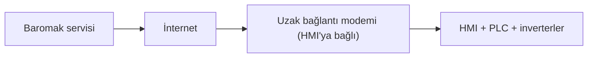
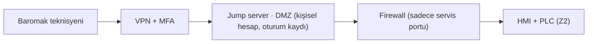

# Lab 4 · Secure Remote Access

**Çıktı:** Secure Architecture  
**Makine:** Baromak LUNA 1300 PRO fırça zımpara  
**Ad Soyad:** Muhammed Cemil Çaka  
**Tarih:** 4. Hafta

PDF hâli: [hafta-4-guvenli-uzak-erisim.pdf](../pdf/hafta-4-guvenli-uzak-erisim.pdf)

> **Kavram:** İki katman, ikisi de şart: **erişim güvenliği** (girişi zorlaştır: ara nokta, VPN, MFA, kişisel hesap, kayıt, varsayılan kapalı) + **emniyet bağımsızlığı** (girse bile insan korunur).

## Görev A — mevcut → hedef

### MEVCUT

- ✗ Bağlantı 7/24 açık
- ✗ Ortak servis kullanıcısı ve parolası
- ✗ MFA yok
- ✗ Kayıt yok, kim neyi değiştirdi bilinmiyor
- ✗ Makine ağı ofis ağıyla aynı (düz ağ)

_Gerçek kurulumu görmedim, ilandaki "uzaktan bağlantı" bilgisine göre tipik hâlini çizdim._

### HEDEF (beş ilke)

- ✓ **Ara nokta:** jump server, makineye direkt bağlantı yok
- ✓ **VPN:** HMI internete açık değil
- ✓ **MFA:** her girişte ikinci faktör
- ✓ **Kişisel hesap + kayıt:** her oturum kaydediliyor
- ✓ **Varsayılan kapalı:** bakım şefi açar, 2 saat sonra kendisi kapanır

_Safety PLC (Z1) bu yoldan hiç görünmüyor, ona uzaktan erişim yok._

## Görev B — functional safety köprüsü

### 1. Saldırgan tüm önlemlere rağmen içeri girerse: emniyet fonksiyonu etkilenir mi? Neden?

Mevcut hâliyle evet, etkilenebilir. Kapak kilidi fırçanın gerçekten durduğuna değil sabit bir süreye bakıyorsa ve fırçanın kaç saniyede duracağı inverterdeki parametreye bağlıysa, saldırgan safety PLC'ye hiç dokunmadan rampayı uzatıp fonksiyonu boşa çıkarabilir (Lab 3, 1. senaryo). Emniyet fonksiyonu kontrol sisteminden gerçekten bağımsız olsaydı saldırgan üretimi durdurabilir, kaliteyi bozabilir, makineyi kilitleyebilirdi ama dönen fırçaya giden kapağı açtıramazdı. Yani erişim güvenliği girişi zorlaştırıyor ama insanı asıl koruyan ikinci katman.

### 2. Emniyet fonksiyonunun kontrol sisteminden bağımsız çalışması için GEREKSİNİMİ yazın (çözümü değil).

- Fırça istasyonlarına erişim sağlayan koruyucuların kilidi, tüm tehlikeli hareketlerin (fırça, osilasyon, konveyör) gerçekten durduğu emniyet fonksiyonu tarafından doğrulanmadan açılmamalıdır.
- Bu doğrulama PLC, HMI, inverter parametreleri ve uzak erişim üzerinden yapılan hiçbir değişiklikten etkilenmemelidir.
- Emniyet fonksiyonunun parametreleri ağ üzerinden değiştirilememeli; değişiklik sadece yetkili kişi tarafından makinenin başında yapılmalı ve kayıt altına alınmalıdır.
- Normal kontrol sistemi arızalanırsa veya iletişim koparsa makine güvenli duruma geçmelidir. Hedef: PLr d.

_Tarafsızlık notu: Bu föy çözüm tasarlatmaz; gereksinimi tanımlatır. Tasarım kararı firmanızındır._

---

_Bu föyün çıktısı **Secure Architecture** → Evidence Pack **EP 02 + EP 06** başlığına oturur._
