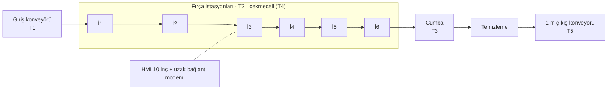
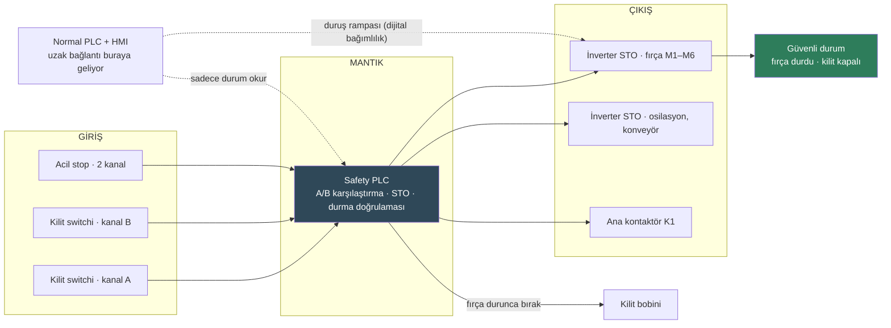

# Laboratuvar Föyü 1 · Makinenin Emniyet Mimarisi

| | |
|---|---|
| Hafta | 1 |
| Makine | Baromak LUNA 1300 PRO Otomatik Fırça Zımpara Makinesi |
| Hazırlayan | Muhammed Cemil Caka |
| Konular | Tehlike bölgeleri · emniyet fonksiyonları · PLr · dijital bağımlılıklar |

PDF hâli: [hafta-1-emniyet-mimarisi.pdf](hafta-1-emniyet-mimarisi.pdf)

## 1. Amaç

Bu föyde LUNA 1300 PRO'da insanı neyin yaralayabileceğini çıkarmak, bu tehlikelere karşı hangi emniyet fonksiyonlarının olması gerektiğini belirlemek ve bunlardan birini (bakım çekmecesi kilidi) girişten çıkışa kadar takip etmek istedim. Son kısımda bu fonksiyonun hangi dijital ayarlara bağlı olduğuna baktım, çünkü sonraki haftalardaki siber güvenlik konuları buradan çıkıyor.

## 2. Makine ve Kapsam

Makine, kapı ve kapakları konveyör üstünde taşıyıp 6 osilasyonlu fırça istasyonundan, bir cumba istasyonundan ve bir temizleme istasyonundan geçiren otomatik bir fırça zımpara makinesi (teknik bilgiler makine-bilgisi.md dosyasında). Kapsamı makinenin kendisiyle sınırladım; parçayı makineye veren ve çıkışta alan kişiler kapsama dahil, toz emiş tesisatının kendisi dahil değil.

_Şekil 1. LUNA 1300 PRO'nun yandan şematik görünümü ve tehlike bölgeleri (kendi çizimim, ölçekli değil)._

## 3. Ön Bilgi

Makine emniyetinde emniyet fonksiyonu, bir şeyler ters gittiğinde insanı korumak için çalışan ve normal üretim kontrolünden ayrı tutulan fonksiyon. ISO 13849-1 bunu üç parça hâlinde düşünüyor: giriş (switch, buton, sensör), mantık (safety PLC ya da emniyet rölesi) ve çıkış (kontaktör, inverterdeki STO). Fonksiyonun ne kadar güvenilir olması gerektiği PLr ile ifade ediliyor; bunu da yaralanmanın şiddeti (S), tehlikeye maruz kalma sıklığı (F) ve tehlikeden kaçınma imkânı (P) belirliyor.

Bu föyde özellikle dikkat ettiğim nokta şu oldu: bugün bu fonksiyonların çoğu kabloyla değil yazılım ve parametreyle ayarlanıyor. Yani bir emniyet fonksiyonunun güvenilirliği, aslında bir dijital konfigürasyonun doğru kalmasına bağlı.

## 4. Uygulama

### 4.1 Tehlike bölgeleri

**Tablo 1. Şekil 1'deki tehlike bölgeleri**

| Bölge | Tehlike | Kim, ne zaman maruz kalıyor |
|---|---|---|
| T1 · Giriş konveyörü | Parmağın ya da elin bant ile parça arasına sıkışıp içeri çekilmesi | Operatör, parça beslerken (sürekli) |
| T2 · Fırça istasyonları İ1–İ6 | Dönen ve osilasyon yapan fırçaya el, eldiven, kıyafet veya saç kaptırma; sarılma | Bakımcı ve operatör, zımpara değişimi ve temizlikte (her vardiya) |
| T3 · Cumba istasyonu | Kenar fırçasına temas, sıkışma | Operatör, kenar ayarı yaparken |
| T4 · Çekmeceli istasyonlar | Motor durdurulsa da ataletle dönmeye devam eden fırça | Bakımcı, çekmeceyi çekerken |
| T5 · Temizleme istasyonu ve çıkış konveyörü | Temizleme fırçasına temas, parçayı alırken sıkışma | Parçayı alan kişi (sürekli) |
| T6 · Makinenin geneli | Kısa/ince parçanın geri fırlaması, ahşap tozu (solunum ve toz yangını), basınçlı hava, 380 V | Makine çevresindeki herkes |

Benim için en önemlisi T4. Diğer bölgelerde tehlike göz önünde, ama T4'te makine "durmuş" görünürken fırça hâlâ dönüyor olabiliyor. Fırçalar ağır olduğu için motorun enerjisi kesildikten sonra birkaç saniye daha dönmeleri normal.

### 4.2 Emniyet fonksiyonları ve PLr

**Tablo 2. Makine için belirlediğim emniyet fonksiyonları**

| Kod | Fonksiyon | S | F | P | PLr |
|---|---|---|---|---|---|
| SF-1 | **Acil durdurma.** Makinedeki acil stoplardan herhangi birine basılınca fırça, osilasyon ve konveyör durur. | S2 | F2 | P1 | d |
| SF-2 | **Kilitli koruyucu.** Çekmece veya bakım kapağı kilitli değilse tehlikeli hareketler başlamaz; kilit, fırçalar tamamen durmadan açılmaz. | S2 | F2 | P1 | d |
| SF-3 | **Giriş ağzı koruması.** Giriş konveyöründe elin içeri girdiği algılanırsa konveyör ve fırçalar durur. | S2 | F2 | P1 | d |
| SF-4 | **Beklenmedik yol almanın önlenmesi.** Kapak kapatılınca makine kendiliğinden kalkmaz, ayrı reset ve start gerekir. | S2 | F1 | P1 | c |

> **Not.** P değerlerinden emin olamadım. Özellikle SF-2'de ataletle dönen fırçayı fark etmek zor diye P2 seçilirse PLr e'ye çıkıyor. Ben fırçanın görülebildiğini ve yavaşladığının fark edildiğini düşünüp P1 aldım, bunu derste sormak istiyorum.

### 4.3 SF-2'nin emniyet zinciri

Ayrıntılı incelemek için SF-2'yi seçtim, çünkü insanın her gün en çok yaklaştığı yer çekmeceli istasyonlar. Şekil 2'de bu fonksiyonun giriş, mantık ve çıkış kısımlarını çizdim.

_Şekil 2. SF-2 kilitli koruyucu fonksiyonunun giriş–mantık–çıkış yapısı._

- **Giriş:** Her çekmecede ve bakım kapağında kilitli emniyet switchi, iki kanallı.
- **Mantık:** Safety PLC. İki kanalı karşılaştırıyor, kapak açma isteği gelince önce motorlara STO veriyor, fırçaların durduğunu doğruladıktan sonra kilidi bırakıyor.
- **Çıkış:** Fırça, osilasyon ve konveyör inverterlerinin STO girişleri; yedek yol olarak da ana kontaktör.
- **Güvenli durum:** Bütün tehlikeli hareketler enerjisiz ve fiilen durmuş, kilit duruş doğrulanana kadar kapalı, hava üfleme kapalı, reset olmadan tekrar kalkış yok.

Burada kendime not ettiğim şey şu: "dur komutu verildi" ile "durdu" aynı şey değil. Güvenli durum ikincisi.

**Tablo 3. Bu makinede normal PLC ile safety PLC'nin farkı**

|   | Normal PLC | Safety PLC |
|---|---|---|
| Görevi | Konveyör hızı, baskı ayarı, osilasyon, reçeteler, otomatik yağlama | Sadece SF-1…SF-4 |
| Yapısı | Tek kanal | Çift kanal, kendini sürekli test ediyor |
| Hata olunca | Ne yapacağı programa bağlı | Durdurma tarafına geçiyor |
| Değişiklik | Sık; HMI'dan ve uzaktan bağlantıyla bile | Nadir; parola ve checksum ile, sadece makine başında |
| Sertifika | Yok | PL / SIL sertifikalı |

### 4.4 Dijital bağımlılıklar

SF-2'nin doğru çalışması için doğru kalması gereken ayarları çıkardım:

**Tablo 4. SF-2'nin dijital bağımlılıkları**

| Bağımlılık | Nerede | Kim değiştirebilir | Değişirse ne olur |
|---|---|---|---|
| Safety programı, kilit ayarları | Safety PLC | Mühendislik yazılımı olan kişi | Kilit erken açılabilir, bir kapak girişi devre dışı kalabilir |
| Fırça inverterlerinin duruş rampası | İnverter parametresi | PLC/HMI üzerinden, uzaktan bağlantıyla da | Fırça daha geç durur. Kilit sabit bir süreye bakıyorsa kapak fırça dönerken açılır |
| STO ayarları | İnverter | Servis | Yanlış ayarlanırsa motor enerjisi kesilmeyebilir |
| Reçeteler (baskı, konveyör hızı) | HMI / PLC | Operatör, uzaktan bağlantı | Dolaylı: fazla baskı → parça fırlaması, ısınma |
| Firmware ve program checksum'ı | Safety PLC | Üretici / servis | Doğrulanmış program değişmiş olabilir ve fark edilmez |

## 5. Değerlendirme

Bu makinede insanı koruyan şeyin sadece kilit ve switchlerden ibaret olmadığını gördüm. SF-2 kâğıt üstünde donanım gibi dursa da doğru çalışması en az üç ayrı yerdeki ayara bağlı: safety programı, inverterin duruş rampası ve STO ayarı. En çok dikkatimi çeken, duruş rampasının normal kontrol tarafından, hatta uzaktan değiştirilebilmesi oldu. Kimse safety PLC'ye dokunmadan fonksiyon zayıflayabiliyor. Gelecek hafta bölgeleri ayırırken uzaktan bağlantının inverterlere ve safety tarafına nasıl ulaştığına özellikle bakacağım.

## 6. Kaynaklar

1. LUNA 1300 PRO ilanı (TWM / AİMSAD): https://twm.com.tr/tr/ilan/luna-1300-pro-firca-zimpara-makinesi
2. Baromak ürün sayfası: https://baromak.com.tr/urun-detay.html?id=luna-1300-pro
3. Safety 4.0 Bootcamp laboratuvar föyleri (konu başlıkları için)
4. ISO 13849-1, Makinelerde güvenlik – Kumanda sistemlerinin güvenlikle ilgili kısımları
