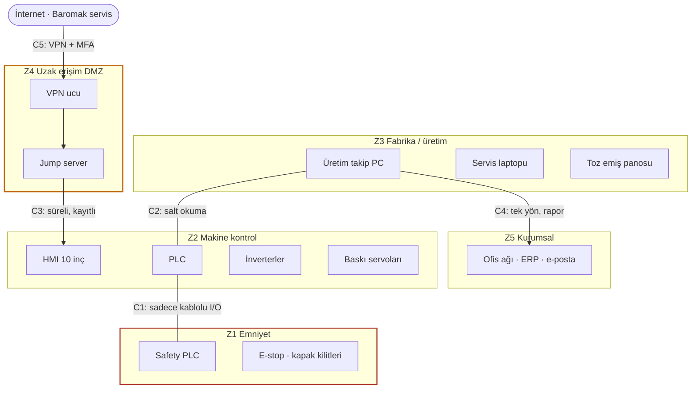

# Laboratuvar Föyü 2 · IEC 62443'e Göre Bölge ve Geçit Tasarımı

| | |
|---|---|
| Hafta | 2 |
| Makine | Baromak LUNA 1300 PRO Otomatik Fırça Zımpara Makinesi |
| Hazırlayan | Muhammed Cemil Caka |
| Konular | Varlık envanteri · zone / conduit · SL-T · uzak servis kuralları |

PDF hâli: [hafta-2-bolge-ve-gecit-tasarimi.pdf](hafta-2-bolge-ve-gecit-tasarimi.pdf)

## 1. Amaç

LUNA 1300 PRO'yu ve çevresindeki cihazları IEC 62443 mantığıyla bölgelere (zone) ayırmak, bölgeler arası geçişleri (conduit) tanımlamak ve üreticinin uzaktan bağlantısı için bir erişim kuralı yazmak.

## 2. Ön Bilgi

IEC 62443-3-2'deki fikir aslında basit: benzer kritiklikteki ve benzer güvenlik ihtiyacı olan cihazları bir bölgede topluyoruz ve her bölgeye bir hedef güvenlik seviyesi (SL-T) veriyoruz. Bölgeler arasındaki her iletişim yolu bir conduit; trafik sadece buradan ve kontrollü şekilde geçiyor. Standardın maddelerini ezberlemek yerine bu mantığı makineye uygulamaya çalıştım.

SL-T değerlerini kendi yorumuma göre verdim: 1 kazara yapılan hatalara karşı, 2 basit ama kasıtlı saldırılara karşı, 3 OT bilgisi olan bir saldırgana karşı koruma.

## 3. Varlık Envanteri

**Tablo 1. Makine ve çevresindeki varlıklar**

| No | Varlık | Ne yapıyor | Kiminle konuşuyor |
|---|---|---|---|
| V1 | PLC | Konveyör, osilasyon, baskı ayarı, yağlama, reçeteler | HMI, sürücüler, safety PLC (I/O) |
| V2 | 10" dokunmatik HMI | Operatör arayüzü, reçete hafızası | PLC, uzak bağlantı modemi |
| V3 | Fırça ve konveyör inverterleri | Motor hızı, duruş rampası, STO | PLC (komut), safety PLC (STO) |
| V4 | Baskı ayar servoları (6 istasyon) | 0,10 mm baskı ayarı | PLC |
| V5 | Safety PLC | Acil stop, kapak kilitleri, STO | Sadece kablolu I/O |
| V6 | Uzak bağlantı modemi | Üreticinin 7/24 servisi | İnternet, HMI/PLC |
| V7 | Servis / mühendislik laptopu | Program yükleme, parametre ayarı | PLC, safety PLC (bağlandığında) |
| V8 | Üretim takip PC'si | Adet, duruş, alarm takibi | PLC (okuma) |
| V9 | Toz emiş panosu | Fan ve filtre; makineye "emiş çalışıyor" sinyali | PLC (kablolu sinyal) |
| V10 | Ofis ağı | ERP, e-posta | Üretim takip PC'si |

## 4. Bölgeler

**Tablo 2. Bölgeler ve hedef güvenlik seviyeleri**

| Bölge | Varlıklar | SL-T | Neden |
|---|---|---|---|
| Z1 · Emniyet | V5, acil stoplar, kilit switchleri, STO hatları | 3 | Bozulursa doğrudan insan yaralanıyor. Ağa hiç çıkmıyor. |
| Z2 · Makine kontrol | V1, V2, V3, V4 | 2 | Üretimi yönetiyor; duruş rampası gibi emniyeti dolaylı etkileyen ayarlar burada. |
| Z3 · Fabrika / üretim | V8, V9, V7 (bağlı değilken) | 1 | Üretim verisi var ama doğrudan hareket kontrolü yok. |
| Z4 · Uzak erişim DMZ | VPN ucu ve jump server (V6'nın yerine) | 2 | İnternetten gelen her bağlantı önce buraya düşmeli. |
| Z5 · Kurumsal | V10 | 1 | Dış tehdit en çok burada ama makineye dokunmuyor. |

HMI'yı ayrı bir bölge yapmayı düşündüm ama PLC ile aynı panoda duruyor ve sürekli onunla konuşuyor, ayırınca bir şey kazanmıyoruz gibi geldi. Safety PLC'yi ise kesinlikle PLC'den ayırdım. V9 toz emiş panosunu nereye koyacağıma karar vermekte zorlandım; makinenin parçası değil ama makine çalışırken emişin açık olması gerekiyor. Sinyali kablolu olduğu için Z3'te bıraktım.

_Şekil 1. Bölge ve geçit diyagramım (seviyeler Purdue modeline göre)._

## 5. Geçitler (Conduit)

**Tablo 3. Bölgeler arası geçişler ve kuralları**

| Kod | Arası | Ne geçiyor | Kural |
|---|---|---|---|
| C1 | Z2 ↔ Z1 | Emniyet durumu (kapak açık/kapalı, reset) | Sadece kablolu I/O. Z2 okuyabilir, Z1'e yazamaz. Safety programı sadece makine başında, anahtarla değişir. |
| C2 | Z3 ↔ Z2 | Adet, alarm, çalışma süresi | Firewall; üretim takip PC'si sadece okur, reçete/parametre yazamaz. |
| C3 | Z4 → Z2 | Uzaktan servis oturumu | Sadece jump server'dan, sadece HMI/PLC servis portuna; süreli ve kayıtlı. İnverter parametresine yazma ayrıca onaylı. |
| C4 | Z3 → Z5 | Üretim raporları | Tek yön; ofisten makineye doğrudan yol yok. |
| C5 | İnternet → Z4 | Baromak teknisyeni | VPN + MFA. |

> **Not.** Servis laptopu (V7) bir conduit değil ama taşınabilir bir conduit gibi davranıyor: başka fabrikalara gidip geliyor ve hem PLC'ye hem safety PLC'ye bağlanabiliyor. Bunun için ayrı kural koydum: sadece firmaya ait, taranmış laptop bağlanır ve bağlantı bakım şefinin onayıyla yapılır.

## 6. Uzak Servis Erişim Kuralları

Üreticinin uzaktan bağlantısı için şu kuralları yazdım:

1. Bağlantı varsayılan olarak **kapalı**. Arıza bildirilince bakım şefi açar, 2 saat sonra kendiliğinden kapanır.
2. Baromak teknisyeni önce **VPN**'e, sonra **jump server**'a bağlanır; makineye doğrudan bağlantı yok.
3. Girişte **MFA** zorunlu.
4. Her teknisyenin **kişisel hesabı** var; "servis / 1234" gibi ortak hesap kullanılmıyor.
5. Oturumun tamamı **kaydediliyor**, yapılan parametre değişiklikleri oturum sonunda bakım şefine listeleniyor.
6. Safety PLC bu yoldan görünmüyor. İnverter duruş rampası ve STO ayarı uzaktan değiştirilemiyor, sadece yerinde.
7. Modemdeki eski "her zaman açık" bağlantı kaldırılıyor.

Üretici "7/24 bağlanıp arıza tespiti yapıyoruz" diyor. Servis açısından bu gerçekten işe yarar ama bizim açımızdan 7/24 açık bir kapı demek. 1. kuralla ikisinin ortasını bulmaya çalıştım.

## 7. Değerlendirme

Bölgeleri ayırırken en çok zorlandığım şey, makinenin "tek bir cihaz" gibi görünmesi oldu. Aslında içinde en az beş farklı kritiklikte parça var. Tablo 3'teki C1 ve C3 kuralları geçen haftaki dijital bağımlılık tablosuyla birebir bağlantılı: duruş rampası ve safety programı tam bu iki geçitten korunuyor. Gelecek hafta bu geçitlerin aşıldığı durumları senaryo olarak yazacağım.

## 8. Kaynaklar

1. LUNA 1300 PRO ilanı (TWM / AİMSAD): https://twm.com.tr/tr/ilan/luna-1300-pro-firca-zimpara-makinesi
2. Baromak ürün sayfası: https://baromak.com.tr/urun-detay.html?id=luna-1300-pro
3. Safety 4.0 Bootcamp laboratuvar föyleri (konu başlıkları için)
4. IEC 62443-3-2, Endüstriyel otomasyon ve kontrol sistemleri için güvenlik – Sistem tasarımı için güvenlik risk değerlendirmesi
