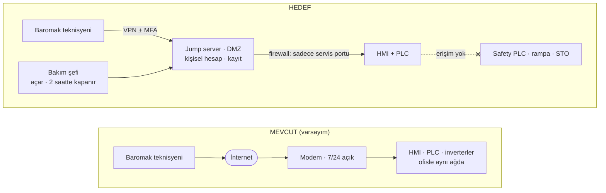
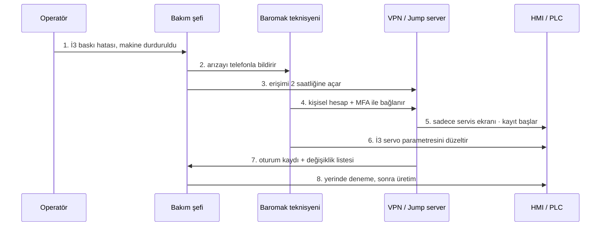

# Laboratuvar Föyü 4 · Güvenli Uzak Servis Erişimi

| | |
|---|---|
| Hafta | 4 |
| Makine | Baromak LUNA 1300 PRO Otomatik Fırça Zımpara Makinesi |
| Hazırlayan | Muhammed Cemil Caka |
| Konular | Mevcut ve hedef mimari · örnek servis oturumu · emniyet bağımsızlığı gereksinimleri |

PDF hâli: [hafta-4-guvenli-uzak-erisim.pdf](hafta-4-guvenli-uzak-erisim.pdf)

## 1. Amaç

Baromak'ın 7/24 uzaktan bağlantısını iki açıdan ele almak: (1) içeri girmeyi zorlaştıran erişim güvenliği, (2) biri içeri girse bile insanı koruyan emniyet bağımsızlığı. Bu föyde teknik çözüm seçmek yerine mevcut durumu, hedefi ve gereksinimleri tanımladım; hangi ürünün kullanılacağı işletmenin kararı.

## 2. Mevcut Durum

Gerçek kurulumu görmedim. Ürün sayfasındaki "uzaktan bağlantı ile 7/24 arıza tespiti" bilgisine göre bu tür makinelerde sık görülen yapıyı varsaydım: HMI'ya bağlı bir modem, internet üzerinden doğrudan gelen servis bağlantısı ve ofisle aynı ağda duran bir makine.

_Şekil 1. Uzak servis bağlantısının mevcut (varsayılan) ve hedef hâli._

Mevcut yapıda gördüğüm zayıflıklar:

- Bağlantı 7/24 açık, kimse açıp kapatmıyor.
- Ortak bir servis kullanıcısı ve parolası var, kimin bağlandığı belli değil.
- MFA yok; parola sızarsa yeterli.
- Oturum kaydı yok, hangi parametrenin değiştiği sonradan bilinmiyor.
- Modemden girilen yol HMI, PLC ve inverterlere kadar açık; geçen haftaki R1 senaryosu tam olarak buradan yapılabiliyor.

## 3. Hedef Mimari

**Tablo 1. Erişim güvenliği ilkelerinin bu makinedeki karşılığı**

| İlke | LUNA 1300 PRO için karşılığı |
|---|---|
| Ara nokta | Jump server; teknisyen HMI'ya doğrudan bağlanmıyor. |
| Şifreli tünel | VPN; HMI ya da modem internete port açmıyor. |
| Güçlü kimlik | MFA; her girişte telefon onayı. |
| Kişisel hesap ve kayıt | Her teknisyene ayrı hesap, oturumun tamamı kaydediliyor. |
| Varsayılan kapalı | Bakım şefi açıyor, 2 saat sonra kendiliğinden kapanıyor. |

Hedef yapıda teknisyenin ulaşabildiği yer HMI/PLC'nin servis ekranıyla sınırlı. Safety PLC ve inverterlerin duruş rampası/STO ayarları bu yoldan hiç görünmüyor.

## 4. Örnek Servis Oturumu

Hedef mimariyi kâğıt üstünde denemek için bir arıza düşündüm: Salı sabahı 3. istasyonun baskı ayarı hata veriyor ve üreticinin uzaktan bakması gerekiyor.

_Şekil 2. Hedef mimaride bir uzak servis oturumunun adımları._

1. Operatör arızayı bakım şefine bildiriyor, makine durduruluyor.
2. Bakım şefi Baromak'ı arayıp arızayı anlatıyor.
3. Bakım şefi uzaktan erişimi 2 saatliğine açıyor.
4. Teknisyen kendi hesabıyla VPN'e bağlanıyor ve telefonuna gelen MFA onayını veriyor.
5. Jump server üzerinden sadece HMI/PLC servis ekranına ulaşıyor; oturum kaydı başlıyor.
6. 3. istasyonun baskı servosundaki parametreyi düzeltiyor.
7. Oturum kapanınca kayıt ve değişiklik listesi bakım şefine gidiyor.
8. Bakım şefi makinenin başında deneme çalıştırması yaptıktan sonra üretime geçiliyor; 2 saat dolunca erişim kendiliğinden kapanıyor.

> **Not.** Bu oturumu yazarken fark ettiğim bir şey oldu: teknisyen baskı servosunu ayarlayabiliyor ama fırça inverterinin duruş rampasına erişemiyor. Bu ayrımı yapmazsak R1 senaryosu bu meşru oturumun içinden bile yapılabilir.

## 5. Emniyet Bağımsızlığı

**Biri bütün önlemlere rağmen içeri girerse ne olur?** Mevcut hâliyle emniyet fonksiyonu etkilenebilir. Kapak kilidi fırçanın gerçekten durduğuna değil sabit bir süreye bakıyorsa ve fırçanın kaç saniyede duracağı inverterdeki bir parametreye bağlıysa, saldırgan safety PLC'ye hiç dokunmadan fonksiyonu boşa çıkarabilir. Emniyet fonksiyonu kontrol sisteminden gerçekten bağımsız olsaydı saldırgan üretimi durdurabilir, kaliteyi bozabilir, makineyi kilitleyebilirdi ama dönen fırçaya giden kapağı açtıramazdı. Yani erişim güvenliği içeri girmeyi zorlaştırıyor, insanı asıl koruyan ise bu ikinci katman.

Bu yüzden çözüm değil, sağlanması gereken şeyleri gereksinim olarak yazdım:

**Tablo 2. Emniyet bağımsızlığı gereksinimleri**

| Kod | Gereksinim | Nasıl doğrulanır |
|---|---|---|
| GR-1 | Koruyucuların kilidi, tüm tehlikeli hareketlerin (fırça, osilasyon, konveyör) gerçekten durduğu emniyet fonksiyonu tarafından doğrulanmadan açılmamalı. | Devreye almada duruş rampası uzatılarak test: kilit fırça dönerken açılmamalı. |
| GR-2 | Bu doğrulama PLC, HMI, inverter parametreleri ve uzak erişimde yapılan hiçbir değişiklikten etkilenmemeli. | Föy 1'deki bağımlılık tablosuyla karşılaştırma; normal PLC kapalıyken fonksiyon testi. |
| GR-3 | Emniyet parametreleri ağ üzerinden değiştirilememeli; değişiklik yalnızca yetkili kişi tarafından makine başında yapılmalı ve kayda geçmeli. | Uzak oturumdan değiştirme denemesi; değişiklik kaydının kontrolü. |
| GR-4 | Normal kontrol sistemi arızalanır ya da iletişim koparsa makine güvenli duruma geçmeli. | PLC ile bağlantı kesilerek test. |
| GR-5 | SF-2 için hedef PLr d sağlanmalı. | ISO 13849-1'e göre hesap ve doğrulama raporu. |

Bu gereksinimlerin hangi cihaz ya da yazılımla karşılanacağı tasarım kararı; onu işletme ve üretici birlikte verir. Ben sadece neyin sağlanması gerektiğini yazdım.

## 6. Değerlendirme

Dört haftanın sonunda aynı noktaya geldiğimi fark ettim: Föy 1'de bulduğum dijital bağımlılık (duruş rampası), Föy 2'de bir geçit kuralına, Föy 3'te en yüksek öncelikli senaryoya, bu hafta da GR-1 ve GR-2 gereksinimlerine dönüştü. Uzaktan bağlantı bu makinenin en kullanışlı özelliklerinden biri ama emniyet açısından da en önemli giriş noktası. Erişimi ne kadar sıkı yaparsak yapalım, insanı korumanın son halkası emniyet fonksiyonunun bu bağlantıdan bağımsız olması.

## 7. Kaynaklar

1. LUNA 1300 PRO ilanı (TWM / AİMSAD): https://twm.com.tr/tr/ilan/luna-1300-pro-firca-zimpara-makinesi
2. Baromak ürün sayfası: https://baromak.com.tr/urun-detay.html?id=luna-1300-pro
3. Safety 4.0 Bootcamp laboratuvar föyleri (konu başlıkları için)
4. IEC 62443-3-3, Sistem güvenlik gereksinimleri ve güvenlik seviyeleri
5. Föy 1, Föy 2 ve Föy 3 (bu çalışmanın önceki haftaları)
